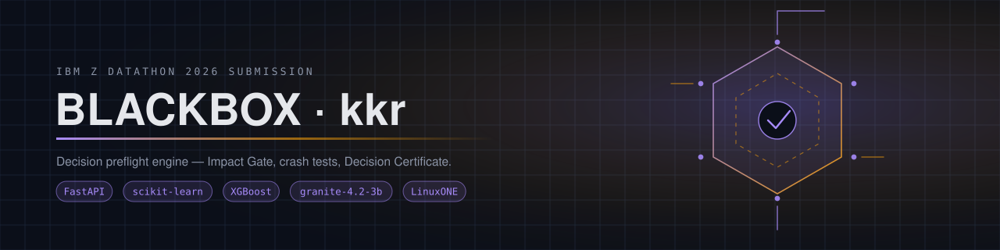
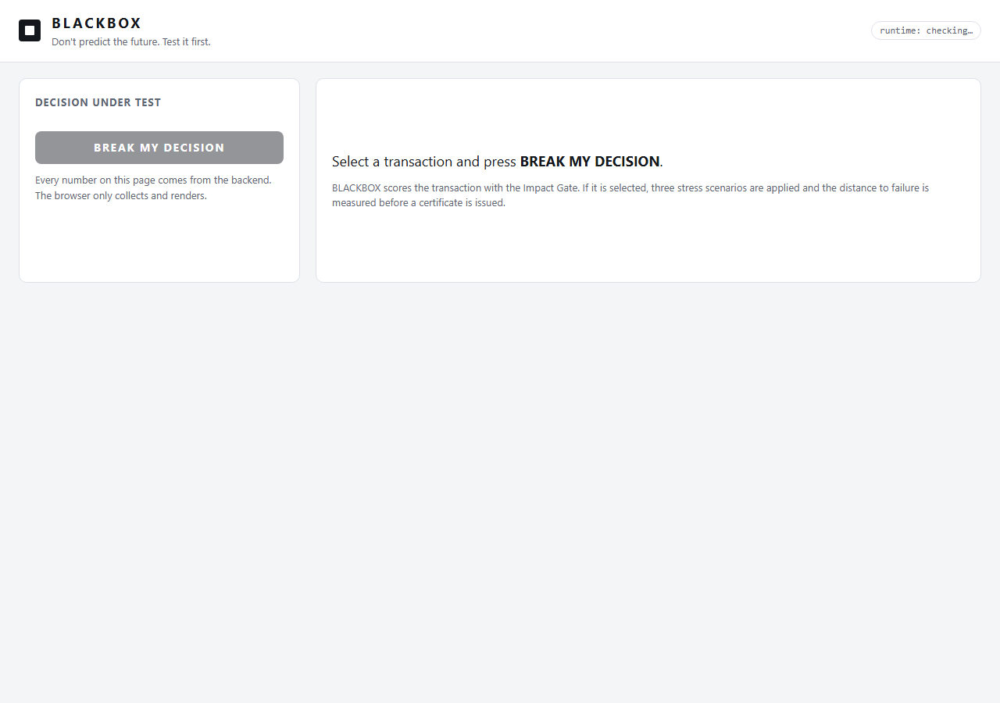
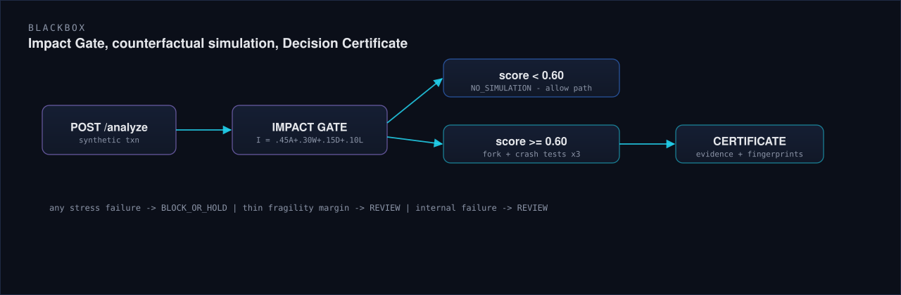

<p align="center">
  
</p>

<p align="center">
  
  
  
  
</p>

# BLACKBOX · kkr — IBM Z Datathon 2026 submission

**Enterprise decision preflight engine.** *Don't predict the future. Test it first.*

This repository is the **submission snapshot** of BLACKBOX as of the 2026-10-18 submission
audit pass. Development continues in [kushalr5600-commits/blackbox](https://github.com/kushalr5600-commits/blackbox).
Known differences: this snapshot documents the audit-fix session (161/161 tests, Granite
4.2-3b verification) that post-dated the initial `blackbox` import.

A calibrated **Impact Gate** decides which transactions deserve expensive counterfactual
simulation. Selected transactions are stress-tested under three frozen scenarios, the
distance to failure (fragility) is measured, and a **Decision Certificate** with real
evidence is issued before the decision is committed. Synthetic data only; research prototype.

<p align="center">
  
  <br/><sub>Dashboard — captured during verification (<code>evidence/browser_check/</code>); interactive click-through confirmed 2026-10-18 (certificate + LLM narrative card).</sub>
</p>

## How it works

<p align="center">
  
</p>

```
POST /analyze -> validate -> load context -> IMPACT GATE (W,A,D,L -> score)
   score < 0.60 : certificate NO_SIMULATION (normal path)
   score >= 0.60: LOCAL STATE GRAPH -> REALITY FORK (baseline) -> CRASH TEST x3 (normal + stress each)
                  -> FRAGILITY SEARCH x3 -> DECISION CERTIFICATE
   any internal failure -> REVIEW certificate (never a silent "safe")
```

| Signal | What it is | Learned? |
|:--|:--|:--|
| M magnitude | amount vs the account's own baseline | no — explainable statistic |
| D dependency | downstream exposure in the local graph | no — deterministic graph feature |
| A anomaly | IsolationForest score, empirical-CDF normalized on the calibration split | yes — scikit-learn |
| U uncertainty | disagreement (std) of the failure ensemble P(fail), /0.5 — RF trees **plus XGBoost bootstrap models** (hybrid) | yes — sklearn + XGBoost |
| W window pressure / L load pressure | dataset-context features used by the active ranking | no — deterministic context features |

**Active decision policy (human-authorized 2026-10-16):** interaction-aware
`I = 0.45 A + 0.30 W + 0.15 D + 0.10 L`, simulate iff `I >= 0.60`. The frozen reference
formula (`0.30 M + 0.30 D + 0.25 A + 0.15 U`) remains implemented and contract-pinned.

An optional **LLM narrative** (IBM Granite via `scripts/llm_service.py`) attaches
plain-language context to `/explain`. It is **advisory only** — scores and decisions never
depend on it. The narrate service auto-detects its backend: a `.gguf` model runs IBM
Granite locally through llama.cpp (`pip install -r requirements-llm.txt`; CPU), anything
else through transformers+torch. Verified on AMD64 with `granite-4.2-3b Q4_K_M`:
`/explain` returns a grounded narrative with the certificate score unchanged.

## Verification status (honest)

| Claim | Status |
|:--|:--|
| 161/161 unit/contract/integration tests (`pytest`; 155 frozen-pinned + 4 reverse doc-contract + 2 C1/disclosure regression) | **VERIFIED** on AMD64 (CPython 3.12.10, sklearn 1.9.1 + xgboost 3.4.1), 2026-10-17 |
| Same suite on LinuxONE / s390x | **VERIFIED** on s390x guest (Ubuntu 24.04.5; sklearn 141/141 + live HTTP rerun recorded under `evidence/results/validation_runs/`) |
| FastAPI routes + smoke test (HTTP PASS, not SKIP) | **VERIFIED** on AMD64 and s390x |
| Dataset SHA-256 matches `manifest.json` | **VERIFIED** |
| Cross-arch gate-score reproducibility (sklearn) | **VERIFIED** — showcase scores byte-identical AMD64 <-> s390x |
| Docker image build on the s390x target | **VERIFIED** — `blackbox:latest` built and run on the guest; `/health` reports `runtime:linuxone` |
| IBM Granite LLM narrative on the target | **VERIFIED** — `/explain` returns `llm_narrative.available=true` (~57s CPU), certificate score unchanged |
| Browser click-through of the dashboard UI | **VERIFIED** — 2026-10-18 via headless click-through: certificate + LLM narrative card render |
| AMD64 results for LinuxONE | **NOT ACCEPTED** — AMD64 verifies AMD64 only |

## Run

```bash
python -m venv .venv && source .venv/bin/activate          # Windows: .venv\Scripts\activate
pip install -r requirements-dev.txt                        # runtime + pytest + httpx
python -m pytest -q
uvicorn backend.main:app --host 0.0.0.0 --port 8000        # open http://127.0.0.1:8000/dashboard
```

Lean NumPy-only runtime: `pip install -r requirements-numpy.txt`, then set
`BLACKBOX_MODEL_BACKEND=numpy`. Full HTTP smoke without sklearn:
`pip install -r requirements-numpy.txt -r requirements-test.txt`. Local Granite:
`pip install -r requirements-llm.txt`.

Diagnostics: `python scripts/diagnose_env.py` · full suite: `python scripts/validate_runtime.py
--include-optional` · gate walk-through: `python scripts/trace_gate.py`.
LinuxONE procedure: [`docs/LINUXONE_RUNBOOK.md`](docs/LINUXONE_RUNBOOK.md).

## Evaluation

Ground truth is the full stress simulation. Primary metric: **failure recall at a fixed
simulation budget** (0.5%, 1%, 2%, 5%, 10%, 100%) against random, amount-only and
anomaly-only baselines. Calibration / validation / locked test splits; the locked test is
evaluated once after freezing (`scripts/run_experiment.py`). Numbers: [`docs/STATUS.md`](docs/STATUS.md).

## IBM LinuxONE (s390x)

`GET /health` reports the real `platform.machine()` and says `linuxone` only on `s390x`.
**VERIFIED on a real s390x guest** (Ubuntu 24.04.5): full suite, live HTTP, hybrid
sklearn+XGBoost models and the Granite narrative cache all run on the target; gate scores
byte-identical to the AMD64 host (synthetic data). Full procedure:
[`docs/LINUXONE_RUNBOOK.md`](docs/LINUXONE_RUNBOOK.md).

## Open-source libraries

| Library | Use | License |
|:--|:--|:--|
| FastAPI | HTTP API | MIT |
| Uvicorn | ASGI server | BSD-3-Clause |
| Pydantic | schemas/validation | MIT |
| NumPy | numerics | BSD-3-Clause |
| scikit-learn | anomaly + risk models | BSD-3-Clause |
| XGBoost | hybrid risk-ensemble members | Apache-2.0 |
| IBM Granite (llama.cpp / transformers) | advisory LLM narrative | Apache-2.0 |
| pytest / httpx (dev only) | tests | MIT / BSD-3-Clause |

## Limitations

Synthetic data and a modelled enterprise; results describe the simulation, not a real
institution. Failure limits, gate weights and the review margin are declared parameters.
Fragility is a bounded interval at stated resolution, not an exact boundary. Not a
production authorization system.

## License

MIT — see [LICENSE](LICENSE).

<p align="center">
  <sub>Solo build by <a href="https://github.com/kushalr5600-commits">Kushal</a> · Active development: <a href="https://github.com/kushalr5600-commits/blackbox">blackbox</a></sub>
</p>
